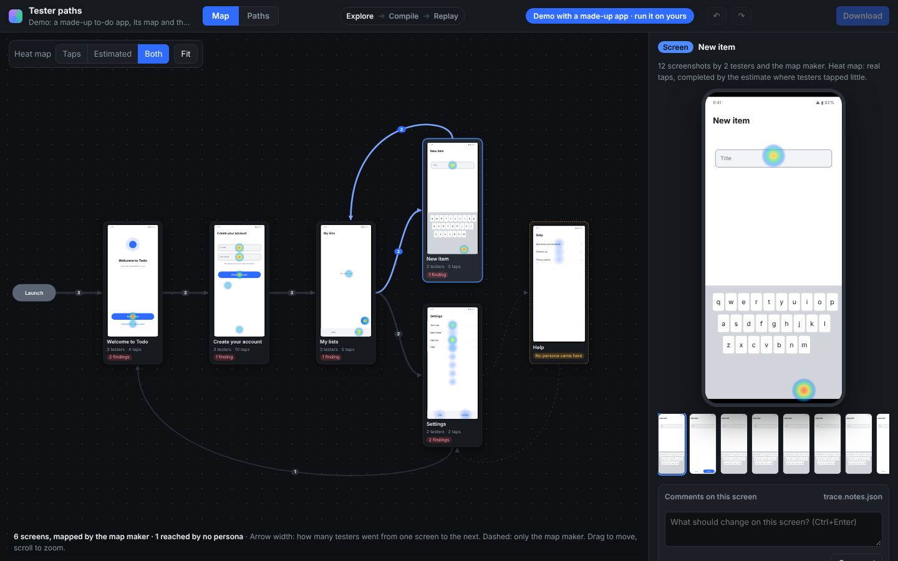

# Watch and edit the paths of the testers (experimental)

Each Android tester leaves its path in `trace.json` ([docs/replay.md](replay.md)). The dashboard draws every screen of the app as a map, puts the paths of the testers on it, and lets you comment each screen and edit each path before it becomes a test.

<a href="https://pierridotite.github.io/mobile-agent-testers/"></a>

[Try the demo online](https://pierridotite.github.io/mobile-agent-testers/), with a made-up app, or [watch the 70-second video](../assets/dashboard-demo.mp4).

```bash
bash scripts/collect.sh <run id>                 # decrypts the results into runs/<run id>/
python3 scripts/dashboard.py runs/<run id>       # opens http://127.0.0.1:8765
python3 scripts/dashboard.py --demo              # a made-up run, to try it
python3 scripts/dashboard.py runs/<map run> runs/<run id>   # several runs on one map
```

Python 3.9 or later, nothing to install. The page runs in your browser and the results never leave your machine: the server listens on `127.0.0.1` only and never serves `trace.params.json`, the texts the agent typed.

## First, find every screen

ECR starts by exploring. Here, that is the job of the map maker: an agent with [briefs/map.md](../briefs/map.md) instead of a persona's brief. It opens every control of every screen once, breadth first, and comes back. Its path is a trace like any other, so each screen it found has a path that replays with no model. Run the workflow with `brief: briefs/map.md`; one persona is enough.

Open its run together with the persona runs. The map then shows every screen of the app, and the screens no persona reached are marked "No persona came here": a part of the app the testers never saw, or never found.

## The map

- **One card per screen**, with the screenshot, how many testers came, how many taps, and the findings seen there. Screenshots of the same screen are grouped, even across languages (by the ids of their elements).
- **Arrows** from one screen to the next. The wider the arrow, the more testers went that way. A dashed arrow is a way only the map maker took.
- **A heat map on each screen**: the real taps of the testers, an estimate of where people would look and tap, or both (the estimate fills in where testers tapped little). The estimate weighs each control by its size and by how often testers tapped it on other screens. A file `NN.saliency.json` next to a screenshot (`{"points": [[x, y, weight], ...]}`, x and y from 0 to 1), from a saliency model of your choice, replaces it.
- Click a screen to open it on the right: its screenshots, its comments, the findings, the testers who came and where they came from and went next. "Open path" shows that tester's path in the Paths view.

Drag to move the map, scroll to zoom. Comments on a screen go to `trace.notes.json` of the first tester who saw it, under `screens`.

## The paths

- **The timeline**, one column per step, like a video editor: the screens the tester went through, the actions, the checks, the comments and the findings of the report on the screens where they were seen. Play it (Space), step through it (arrows), drag the red playhead.
- **The screen before each step**, with where the finger landed and the element that was under it. A swipe is an arrow.
- **A heat map of the taps**, for this tester or for all of them. Screenshots of the same screen are grouped, even across languages (by the ids of their elements), so the map adds up every tester who went through it.
- **The Maestro flow** the path compiles to, with the lines of the selected step highlighted.
- The tester's report and findings.

## What you can edit

- Reorder steps by dragging them, delete, duplicate, or add one. A new step picks its target on the screen.
- Change how a step finds its element: by name, by id, or as a last resort by position. "Pick on the screen" fills it from the saved screen tree.
- Write the intent of a step. It goes into the flow as a comment.
- Add checks after a step: what must be visible, or not. Mark a check "Is a bug" when it was false during the run: the flow fails until the bug is fixed, then the check stays as a guard. A comment can become such a check in one click ("Make a test").
- Comment any step, or the whole path. Comments go to `trace.notes.json`, next to the trace.

Undo and redo with Ctrl+Z and Ctrl+Shift+Z, save with Ctrl+S. Saving writes `trace.json` back, still a valid trace, and keeps the explored one as `trace.explored.json` the first time. Step ids never change, so comments and the flow's source map still point to the right step.

## With Explore-Compile-Replay

The flow shown in the page is compiled the same way as [Explore-Compile-Replay](https://github.com/pierridotite/explore-compile-replay) does. To check each save and compile with the real command (Node 22.18 or later):

```bash
git clone https://github.com/pierridotite/explore-compile-replay ../explore-compile-replay
(cd ../explore-compile-replay && pnpm install)
python3 scripts/dashboard.py runs/<run id> --ecr ../explore-compile-replay
```

A save is then refused if ECR finds the trace invalid, and "Compile with ECR" in the Maestro flow tab compares ECR's flow with the preview.

## The online demo

`python3 scripts/dashboard.py --demo --export site/` writes the page and the made-up run as static files that any web host can serve. With no server, edits stay in the page and Save downloads the edited `trace.json`. Only the demo can be exported: a real run is private.

## Limits

- Android only, like the traces.
- The estimated heat map is a guess from the screen's controls, not a model trained on eye tracking. Use real taps, or a saliency file, when it matters.
- Screenshots are grouped by the ids of their elements. An app without ids (many Flutter apps) is grouped by the names of its buttons, so the same screen in two languages counts as two.
- The page has been tried on the demo run and on traces written by the offline tests. Not yet on a run on a real emulator.
